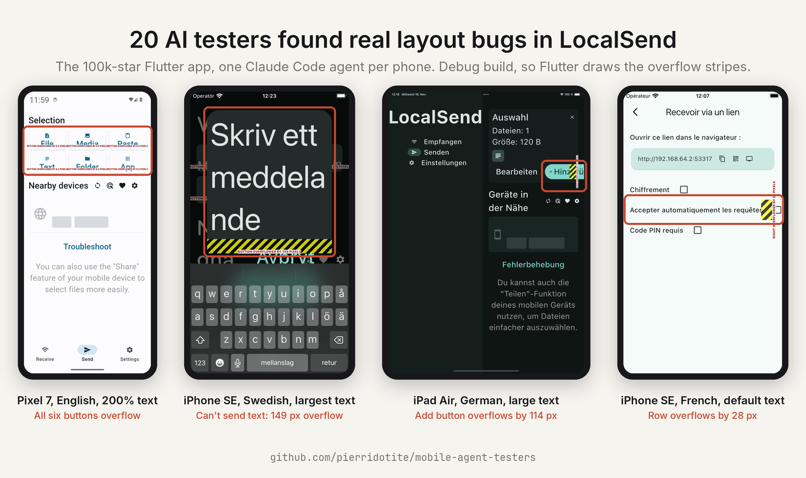
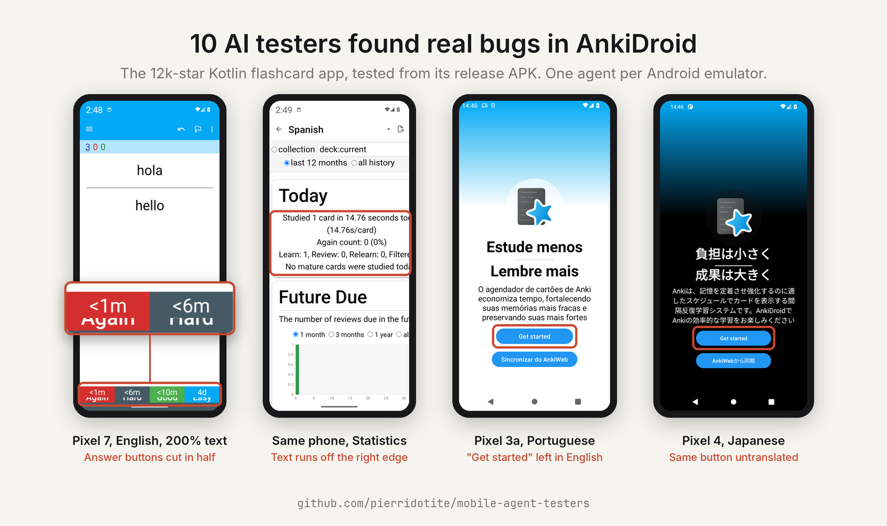

# Uygulamalı örnekler

[English](../../../docs/examples.md) · [简体中文](../../zh-CN/docs/examples.md) · [日本語](../../ja/docs/examples.md) · [Español](../../es/docs/examples.md) · [Português](../../pt-BR/docs/examples.md) · [Tiếng Việt](../../vi/docs/examples.md) · Türkçe

Açık kaynak uygulamalarda yapılmış gerçek çalıştırmalar; hiçbir hata önceden yerleştirilmedi. Buradaki her sayı, tüm raporların cihaz cihaz listelendiği [çalıştırma sonuçlarından](../../../docs/runs/) alınmıştır.

## Yalnızca erişilebilirlik değil

En dikkat çekici ekran görüntüleri büyük yazı boyutundan geliyor, ancak bu ajanların raporladıklarının küçük bir kısmı. Her personanın bir hedefi var ("bir görevi İngilizce kullanmadan tamamla", "her metin alanını Türkçe karakterler, emoji ve çok uzun metinlerle doldur", "işin ortasında uygulamadan çık, sonra geri dön") ve bu hedefe yeni bir kullanıcı gibi ulaşmaya çalışıyor. Bu yüzden ajanlar önlerine çıkan her engeli raporluyor:

- **Bozuk akışlar ve sessiz hatalar**: sürekli yüklenen ve hiçbir cihaz bulunamadığını hiç söylemeyen bir cihaz listesi (20 telefonun 12'sinde), yalnızca "Error" yazan başarısız bir gönderim, bir adres cevap vermediğinde sonsuza kadar bekleyen bir diyalog, yanlışlıkla yapılan tek bir dokunuşta yazılanları silen bir metin diyaloğu.
- **İlk kurulum ve izinler**: AnkiDroid, kullanıcı sistem ayarlarından tüm dosyalara erişim izni verene kadar kurulumu hiçbir açıklama yapmadan engelliyor (10 ajanın 8'i).
- **Çeviriler**: Portekizce, İspanyolca ve Japonca telefonlarda İngilizce kalan "Get started" butonu, Portekizcede "Jogo da velha" (XOX oyunu) olarak etiketlenmiş # sekmesi, Arapçada "B 14" şeklinde yazılan boyutlar, telefonun tarih biçimi yerine ISO biçiminde gösterilen tarihler ve yalnızca İngilizce olan bir gizlilik politikası.
- **Metinler**: Flutter'ın resmi örneğinde bir yazım hatası, "Files: 1" olarak sayılan bir metin mesajı, ana ekranda açıklaması olmayan "#16 #15".
- **Cihazlar**: telefon düzenini dar bir sütunda gösteren tabletler, İptal ve Onayla butonlarını kapatan klavye, listenin son öğelerini kapatan Android gezinme çubuğu, karanlık modu desteklemeyen bir uygulama.
- **Veriler**: uygulama yeniden başlatıldığında hiçbir verinin korunmaması (demo uygulamada).

LocalSend'de bulunan 46 hatanın 34'ünün yazı boyutu ya da erişilebilirlikle bir ilgisi yoktu. Her rapor ayrıca personanın görüşü ve 10 üzerinden bir puanla (uygulamayı kullanmaya devam eder miydi?) bitiyor. Böylece bir çalıştırma yalnızca neyin bozuk olduğunu değil, yeni kullanıcıların nerede kaybolduğunu da gösteriyor.

## LocalSend: 20 ajan, 20 cihaz, 14 dil

<p align="center"></p>

[LocalSend](https://github.com/localsend/localsend), 100 bin yıldızlı bir Flutter uygulaması. Ajanların bulduklarından bazıları:

- iOS'un en büyük yazı boyutunda İsveççe iPhone SE: mesaj diyaloğu 149 px taşıyor; metin alanı ve Onayla butonu ekranın dışında kaldığı için metin göndermek hiç mümkün olmuyor.
- Android'in %200 yazı ölçeğinde Pixel 7: altı Gönder butonunun hepsi taşıyor ve etiketleri yarıdan kesiliyor. İlk erişilebilirlik boyutundaki İtalyanca bir iPhone 16 Plus'ta da aynı sorun var.
- Büyük yazı boyutunda Almanca iPad Air: "Hinzufügen" kartının 114 px dışına taşıyor, Ayarlar'daki değerler de kelimenin ortasından bölünüyor.
- Varsayılan yazı boyutunda Fransızca iPhone SE: "Recevoir via un lien" 28 px taşıyor ve bir onay kutusunu gizliyor.
- İspanyolca Pixel Tablet: klavye, adres diyaloğundaki İptal ve Onayla butonlarını kapatıyor.
- Başarısız bir manuel gönderimde hiçbir sebep belirtilmeden yalnızca "Error", "Erreur", "Fehler", "エラー", "Hata" ya da "Erro" yazıyor. iOS'ta cevap vermeyen bir adres, diyaloğu hiçbir ilerleme göstermeden bekletiyor (üç ajan).

Toplam 103 rapor (1 engelleyici, 15 önemli). Elle gruplandığında 46 farklı hata çıkıyor ve bunların çoğunu yalnızca tek bir telefon görmüş:

<picture>
  <source media="(prefers-color-scheme: dark)" srcset="../../../assets/bugs-per-phone-dark.svg">
  
</picture>

Başlangıçtan son rapora kadar 69 dakika (Free plan aynı anda 5 macOS işi çalıştırabiliyor), 20 telefon için 4,62 $ model maliyeti. Cihaz cihaz tüm raporlar: [docs/runs/localsend-20.md](../../../docs/runs/localsend-20.md). Kendiniz çalıştırmak için:

```bash
gh workflow run agent-testers.yml -f source_repo=localsend/localsend -f app_dir=app \
  -f app_id=org.localsend.localsend_app -f android_personas=all -f ios_personas=all -f record_video=true
```

## AnkiDroid: 10 ajan, doğrudan release APK'sı ile

<p align="center"></p>

[AnkiDroid](https://github.com/ankidroid/Anki-Android), 12 bin yıldızlı bir Kotlin uygulaması. Build almadan, doğrudan GitHub release'indeki APK ile 10 Android emülatöründe 10 ajan çalıştı:

- Android'in %200 yazı ölçeğinde Pixel 7: Again / Hard / Good / Easy butonları yarıdan kesiliyor ve İstatistikler metni sağ kenardan taşıyor. Başka bir ajan, butonların 2.26 alpha sürümünde de kesildiğini buldu; "Show large answer buttons" ayarı açıkken her iki satırda da.
- Karşılama ekranı Portekizce, İspanyolca ve Japonca cihazlarda "Get started" diyor, ekranın geri kalanı ise çevrilmiş (üç ajan bunu birbirinden bağımsız buldu).

83 rapor, 43 farklı soruna karşılık geliyor (bunların ikisi uygulamadan değil, Android 10 ve 11 emülatör imajlarındaki eski sistem WebView'ından kaynaklanıyor). Başlangıçtan son rapora kadar 10 dakikadan kısa, 10 telefon için 4,69 $ model maliyeti. Tüm raporlar: [docs/runs/ankidroid-10.md](../../../docs/runs/ankidroid-10.md). Kendiniz çalıştırmak için:

```bash
gh workflow run agent-testers.yml -f app_dir=. -f app_id=com.ichi2.anki -f brief=briefs/ankidroid.md \
  -f android_build="curl -fsSL -o anki.apk https://github.com/ankidroid/Anki-Android/releases/download/v2.25.3/AnkiDroid-2.25.3-full-universal.apk" \
  -f apk_path=anki.apk -f android_personas=all -f ios_personas=none -f block_hosts="ankiweb.net www.google-analytics.com"
```

## Flutter'ın resmi animasyon örneği

<p align="center"></p>

[flutter/packages içindeki örnek uygulamada](https://github.com/flutter/packages/tree/main/packages/animations/example), Pixel 7'deki bir ajan ile Fransızca bir iPhone SE'deki başka bir ajan aynı yazım hatasını, "Streamling your courses" ifadesini ([110. satır](https://github.com/flutter/packages/blob/main/packages/animations/example/lib/shared_axis_transition.dart#L110)), birbirinden bağımsız olarak raporladı. Android'deki ajan ayrıca uygulamanın karanlık modu desteklemediğini fark etti. 19 dakika, 0,47 $ model maliyeti.

Kendi uygulamanızda denediniz mi? [Bulgularınızı paylaşın](https://github.com/pierridotite/mobile-agent-testers/issues/new?title=Finding:%20), [çalıştırma sonuçlarına](../../../docs/runs/) eklensin. Bu uygulamalardan birinin geliştiricisiyseniz ve bir bulgunun hatalı olduğunu düşünüyorsanız bir issue açın; bulgu düzeltilir ve çalıştırma tekrarlanır.
